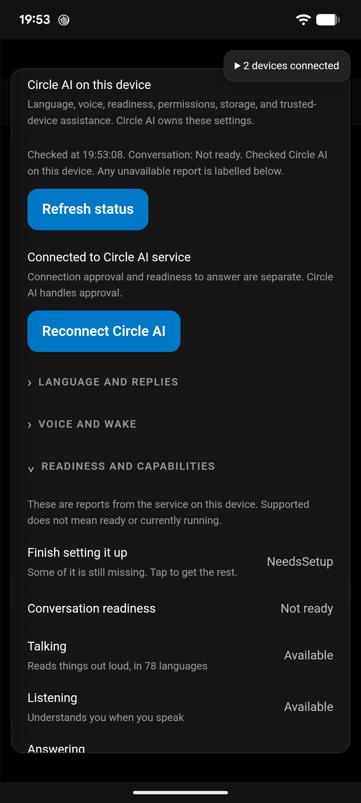
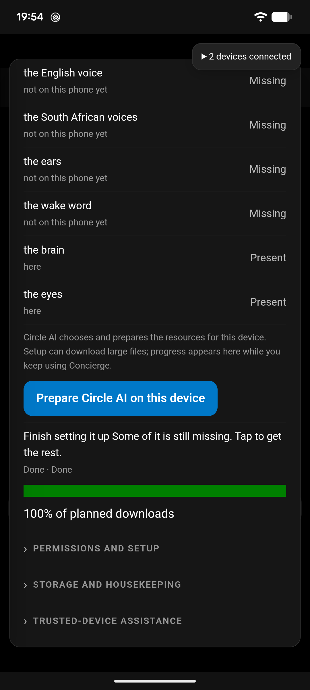
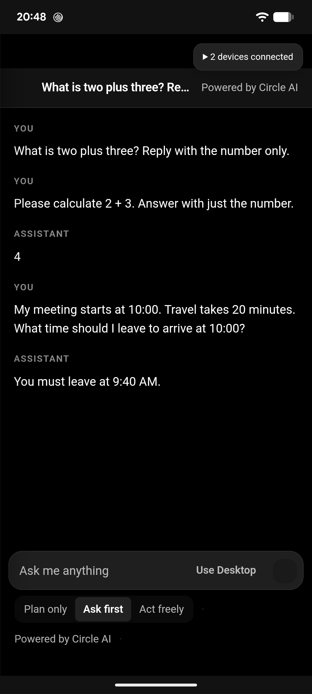

# Android service consumer and setup

Concierge consumes the installed Circle AI service. Circle AI owns resource
selection, preparation, session history and inference. The consuming app exposes
supported setup commands and progress in its own Settings panel; it does not
require the separate Circle AI controls app.

## Implemented

- Android chat uses the published Binder chat link and durable conversation ID.
  Concierge's isolated model worker and Android download coordinator are no
  longer registered as the Android chat/preparation owner.
- Local ready conversations stay on the phone even when Desktop has more RAM.
  Setup or authorization does not silently transfer the query. Explicit capability
  unavailability or local failure can select a ready Desktop; manual Use Desktop
  remains available independently.
- Settings reads the service's setup plan, invokes SetupStart only from an explicit
  button, and polls SetupProgress without blocking the UI thread. The published
  SDK documents the fraction as byte-weighted across the whole planned download;
  the initial per-resource label was wrong and has been corrected. Current step,
  phase and the service's remaining-time estimate are retained. Readiness comes from the
  separate service readiness report, never from a 100% download.
- Opening Settings performs reads only. Closing the panel stops its polling, not
  service-owned preparation. Failed progress checks clear the stale percentage.
- Android no longer sends users to the sample/controls app for settings. Android
  permission management and service-owned connection consent still use their
  respective platform approval screens.
- Connection and conversation readiness are visibly separate. Approval refreshes
  reports automatically; Refresh status shows its completion time and readiness.
  Reopening the panel during Fetching/Checking does not enable duplicate setup.
- Text readiness is separate from overall/voice setup. The installed SDK documents
  AbilityState.On as downloaded, wired and actually working; Concierge reads the
  service's Answering=On report to allow text when voice setup remains incomplete.
  It does not infer readiness from model files. The current wire shape has no
  stable capability ID, so the SDK's English Answering title is matched exactly;
  unknown/localized titles fail closed rather than guessing which ability it is.

## Measured verification and limits

- The updated Android builds were installed on PixieDust successfully.
  The service reported NeedsSetup; its setup plan reported 1,386,691,327 bytes for
  the brain and 311,428,914 bytes for the eyes (1,698,120,241 bytes total).
- The focused runtime, routing, settings, handheld, and durability suite passed
  80 tests with zero failures after separating text readiness. Tests cover no download
  on panel opening, genuine service progress, invalid progress rejection, setup
  refusal, local-first routing and manual transfer visibility.
- Latest Android Debug build passed with zero errors and 175 warnings, elapsed
  2 minutes 21.05 seconds. Warnings include existing package vulnerability and
  native-library compatibility reports; a successful compile does not clear them.
  Both installs returned Success. Screenshots and live UI checks were performed
  on PixieDust, using its existing pairing.
- User approved starting service setup. Circle AI accepted SetupStart and reported
  Fetching, Checking and Done through Concierge. The UI remained responsive while
  changing settings sections and while manually sending a query to Desktop.
- Normal Send during NeedsSetup retained the query on the phone. Desktop's prompt
  diagnostic remained at 14:01:32.1339814 JST. Manual Use Desktop then updated it
  to 19:34:39.4378862 JST; its reply at 19:34:54.101 JST was
  "Two plus three equals **five**." The conversation event identifies the producer
  as "Qwen3.5-0.8B-MNN (Circle AI service)".
- On the updated client, Refresh status completed at 19:52:55 JST. Reconnect
  obtained native service consent GRANTED at 19:53:08.371 JST, automatically
  refreshed the report, and displayed Connected to Circle AI service.
- Initial diagnosis (superseded for text): after
  setup reached Done/100%, SetupReadiness remained NeedsSetup/canTalk=0 and
  SetupPlan returned no rows. SetupCensus reported brain and eyes Present, but
  English voice, South African voices, ears and wake word Missing. One setup retry
  completed immediately without changing readiness. That coarse readiness was
  incorrectly treated as the text-chat gate. The per-ability Answering=On report
  allows text independently. No model/file provisioning logic was added to
  Concierge to replace the service-owned plan.
- **Actual local replies are now verified; reliable startup and accuracy are not.**
  Fresh conversation 71506603-aa93-45dd-b6b0-380bdd3c234a was sent using normal Send
  on PixieDust. At 20:38:16 JST its first turn failed while the service logged
  node=null, then loaded Qwen3.5-2B-MNN and logged brain ready at 20:38:35.435.
  At 20:40:56.541 it answered "4" to "Please calculate 2 + 3. Answer with just
  the number." This is wrong. At 20:46:01.940 it answered "You must leave at
  9:40 AM." to a 10:00 meeting with 20 minutes' travel, which is correct.
  Both reply events identify Circle AI Android service. Desktop's processing
  diagnostic remained at 19:34:39.4378862 JST throughout; its history receives
  synchronized copies, not execution credit.
- Voice approval required Android authentication. It was deferred/cancelled to
  test already-approved text access; no Voice grant or listening activation was
  made. Incomplete voice setup remains visible independently of text readiness.
- The installed SDK link has no language, cache-limit or borrowing preference
  getters/setters. Concierge labels those gaps rather than storing ineffective
  local switches. Resident/wake mutation verbs exist but are not yet surfaced in
  this settings panel.
- Android chat currently sends Agentic=false. Native service actions are not
  enabled without a verified approval/cancellation contract. Text replies arrive
  as one completed reply because this published Binder chat link does not stream
  chunks. These are real differences from the Windows service adapter.
- Older client-only conversation history is not imported into the service session.
  The service receives the current user query and owns history from its first
  service turn; Concierge retains its displayed conversation log.

The settings controls, manual Desktop path and local Android transport have
practical verification. Cold startup, reliable answer accuracy, voice setup,
native action approvals and missing preference setters remain explicit acceptance
work. See the service handoff report for concrete reproduction details.

